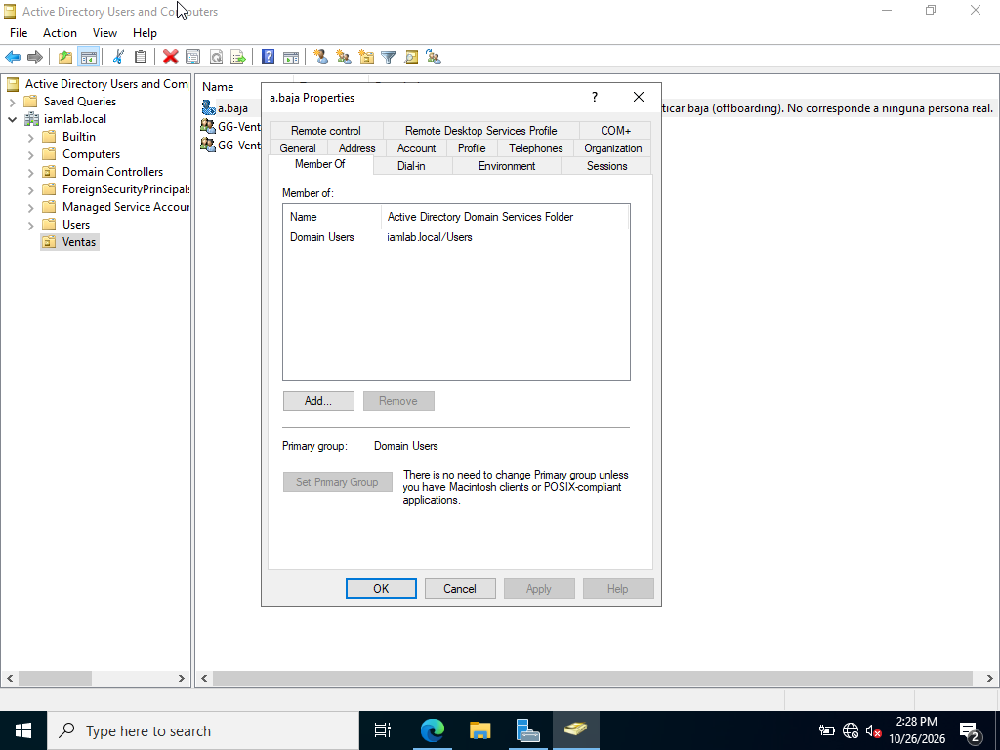
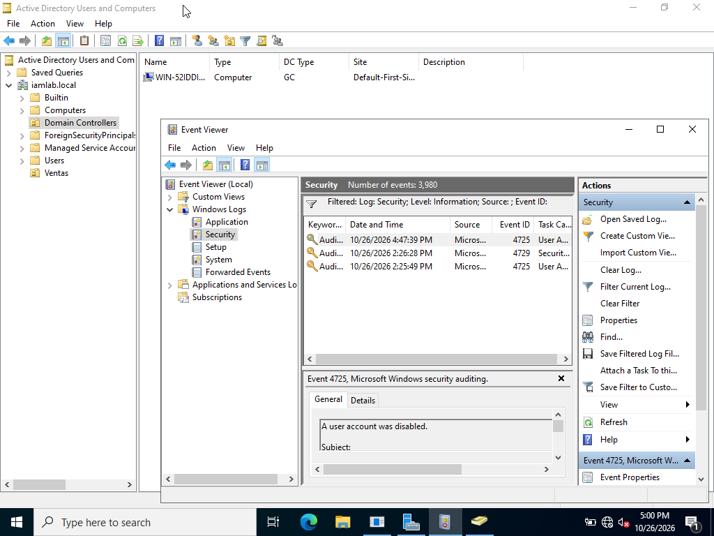

# lab-iam-junior · Gestión de identidades y accesos (IAM) en Active Directory con evidencias para auditoría

> **⚠️ CASO SIMULADO.** `a.baja` es un usuario ficticio creado para practicar un proceso de baja (*offboarding*). **No corresponde a ninguna persona real.** El dominio `iamlab.local` es un laboratorio personal en VirtualBox, sin datos de ninguna empresa.

Laboratorio de operaciones IAM de nivel 1: altas, cambios y bajas de usuarios en Active Directory y permisos asignados por grupos (RBAC), con una regla que se aplica a todo: **cada acción deja una evidencia que un auditor puede comprobar sin tener que preguntarme**. Incluye la autoauditoría de mi propia ejecución, con los hallazgos que he encontrado.

## En 30 segundos

| Qué se demuestra | Cómo | Evidencia |
|---|---|---|
| **Alta con mínimo privilegio** (Joiner) | `a.baja` en `OU=Ventas`, miembro solo de `Domain Users` y `GG-Ventas` | [01 OU](evidencias/01-alta-joiner-OU-Ventas.png) · [01 Member Of](evidencias/01-alta-joiner-memberof-GG-Ventas.png) |
| **Baja y revocación** (Leaver) | Cuenta deshabilitada y retirada de `GG-Ventas` | [02 Member Of](evidencias/02-baja-leaver-memberof-revocada.png) · [02 Account](evidencias/02-baja-leaver-Account-is-disabled.png) · [02 OU](evidencias/02-baja-leaver-OU-deshabilitada.png) |
| **Trazabilidad de la baja** | Eventos 4725 (14:25:49) y 4729 (14:26:28), coherentes con las capturas de antes (14:21) y después (14:28) | [03 eventos](evidencias/03-auditoria-eventos-4725-4729.png) · [línea temporal](evidencias/README.md#línea-temporal-del-26102026) |
| **Registro de solicitudes** | Cada acción con su fila, sus eventos y su evidencia | [registro](registros/registro-solicitudes-acceso.csv) |
| **RBAC** | Permisos por grupo de rol: `GG-Ventas` y `GG-Ventas-RO` | [docs/02](docs/02-RBAC-y-minimo-privilegio.md) |
| **ISO/IEC 27001:2022** | Controles A.5.16, A.5.18 y A.8.15 (en la versión 2013: A.9.2 y A.12.4) | [docs/03](docs/03-ISO27001-2022-control-de-accesos-y-evidencias.md) |

<p>



</p>

## Por qué hice este lab

Trabajo en operaciones, en remoto, en una empresa de eficiencia energética. Mi día a día es gestionar expedientes y reclamaciones con plazo: registrar cada solicitud, hacer el seguimiento hasta el cierre y mantener la documentación localizable en Excel y SharePoint.

Una petición de alta o de baja de accesos es el mismo tipo de trabajo: llega una solicitud, se ejecuta dentro de plazo, se registra y se puede demostrar después. Este laboratorio aplica esa forma de trabajar a la gestión de identidades.

## Entorno

- **Dominio:** `iamlab.local`, con un controlador de dominio Windows Server 2022 en VirtualBox. La interfaz está en inglés, así que la documentación cita los nombres tal como aparecen en pantalla (*Member Of*, *Domain Users*, *Account is disabled*).
- **Unidad organizativa:** `OU=Ventas,DC=iamlab,DC=local`.
- **Grupos de seguridad globales:** `GG-Ventas` (rol Ventas) y `GG-Ventas-RO` (rol de solo lectura).
- **Usuario de prueba:** `a.baja`, simulado. Su campo *Description* en AD lo indica, de modo que el aviso aparece en las propias capturas.
- **Herramientas:** Active Directory Users and Computers, Event Viewer, VirtualBox y un registro de solicitudes en CSV que se abre en Excel.

## Casos

| # | Caso | Estado | Detalle |
|---|---|---|---|
| 1 | Joiner: alta de `a.baja` en Ventas | ✅ Estado verificado con capturas · ⚠️ eventos de creación (4720/4728) pendientes de exportar | [docs/01](docs/01-Joiner-Mover-Leaver.md#joiner-alta) |
| 2 | Leaver: baja y revocación | ✅ Ejecutado y evidenciado con capturas y eventos 4725/4729 · ⚠️ plazo no demostrable (H-02) | [docs/01](docs/01-Joiner-Mover-Leaver.md#leaver-baja) |
| 3 | Revisión de accesos de `GG-Ventas` | 📄 Procedimiento escrito · primera ejecución pendiente (`SIM-003`) | [docs/03](docs/03-ISO27001-2022-control-de-accesos-y-evidencias.md#revisión-de-accesos-de-gg-ventas) |
| 4 | Mover: cambio de rol | 📄 Procedimiento escrito, sin ejecutar | [docs/01](docs/01-Joiner-Mover-Leaver.md#mover-cambio-de-rol) |

## Hallazgos de la autoauditoría

Revisé mis propias evidencias como lo haría un auditor. Esto es lo que encontré:

| ID | Hallazgo | Evidencia | Acción correctora |
|---|---|---|---|
| H-01 | `a.baja` tiene marcada *Password never expires*. Contradice mi procedimiento de alta (contraseña temporal con cambio obligatorio) y, en un entorno real, sería una desviación de la política de contraseñas (A.5.17). | [02 Account](evidencias/02-baja-leaver-Account-is-disabled.png) | Desmarcarla y dejar evidencia del cambio (evento 4738). Las cuentas nuevas se crean con *User must change password at next logon*. |
| H-02 | No anoté la hora de la solicitud de baja simulada (`SIM-002`) antes de ejecutarla. Sin ella, el plazo de 24 h no se puede demostrar con evidencia. | [registro](registros/registro-solicitudes-acceso.csv) | Registrar siempre la solicitud antes de tocar AD. |
| H-03 | La captura 03 no muestra la cuenta de destino ni los eventos del alta (4720/4728), e incluye un tercer evento 4725 a las 16:47:39 que no puedo atribuir con lo que se ve. | [03 eventos](evidencias/03-auditoria-eventos-4725-4729.png) | Exportar la línea temporal del registro de Seguridad filtrada por `a.baja` y documentar el evento de las 16:47. |

## Mapeo con ISO/IEC 27001:2022

| Control (2022) | Qué exige, en resumen | Qué hago en el lab | Equivalencia 2013 |
|---|---|---|---|
| **A.5.16** Gestión de identidades | Gestionar el ciclo de vida completo de las identidades | Alta y baja de `a.baja`, con cada paso registrado | A.9.2.1 |
| **A.5.18** Derechos de acceso | Conceder, revisar, modificar y retirar los accesos según la política de control de acceso | Alta solo en `GG-Ventas` y retirada en la baja | A.9.2.2, A.9.2.5, A.9.2.6 |
| **A.8.15** Registros de eventos | Generar, conservar y proteger los registros de actividad | Eventos 4725 y 4729 del registro de Seguridad (4720 y 4728 pendientes de exportar) | A.12.4.1 a A.12.4.3 |

La versión 2013 de la norma dejó de ser válida para certificar el 31 de octubre de 2025. Este repositorio usa la numeración de 2022 e indica la antigua solo como referencia.

## Por qué esto importa en entornos industriales (OT)

Este laboratorio es un entorno IT (Active Directory). Mi relación con OT es de criterio, no de experiencia en planta. Lo que traslado:

- **En OT manda la disponibilidad.** Una cuenta que nadie revoca, como la de un técnico de un proveedor que ya terminó su trabajo, es un riesgo directo para la continuidad del proceso. Por eso el objetivo de baja en menos de 24 horas y la revisión periódica.
- **Cuentas nominales, no compartidas.** Si varias personas usan la misma cuenta, el registro no permite saber quién hizo qué. En este lab cada acción queda asociada a una cuenta y a una hora.
- **Marco normativo.** La Directiva NIS2 (UE) 2022/2555 incluye las políticas de control de acceso entre las medidas de gestión de riesgos de ciberseguridad (art. 21.2.i) y sitúa la energía entre los sectores de alta criticidad (anexo I).

## Límites del laboratorio

- Un solo controlador de dominio, sin usuarios reales y sin conexión con ningún sistema de producción.
- Solicitudes y aprobaciones simuladas. En una empresa llegarían por ticket desde RRHH o desde el responsable del área.
- Ejecuto y verifico yo misma. En un entorno real la verificación la haría otra persona (segregación de funciones, ISO/IEC 27001:2022 A.5.3).
- Solo herramientas nativas de Windows Server: no se usa ninguna plataforma de gobierno de identidades (IGA) ni de accesos privilegiados (PAM).
- Las evidencias corresponden a una única ejecución, el 26/10/2026.

## Próximas iteraciones

- Cerrar H-01, H-02 y H-03 con evidencia.
- Primera revisión de accesos de `GG-Ventas` (`SIM-003`).
- Caso Mover: un usuario simulado que pasa de `GG-Ventas` a `GG-Ventas-RO`.
- Carpeta compartida de Ventas con permisos NTFS asignados a `GG-Ventas` (modificar) y `GG-Ventas-RO` (lectura).
- Cuenta de un proveedor externo con fecha de caducidad (*Account expires*) dentro de un grupo de acceso remoto para mantenimiento: el caso más parecido a un acceso en OT.

## Estructura del repositorio

```
lab-iam-junior/
├── README.md
├── docs/
│   ├── 01-Joiner-Mover-Leaver.md
│   ├── 02-RBAC-y-minimo-privilegio.md
│   └── 03-ISO27001-2022-control-de-accesos-y-evidencias.md
├── evidencias/
│   ├── README.md
│   ├── 01-alta-joiner-OU-Ventas.png
│   ├── 01-alta-joiner-memberof-GG-Ventas.png
│   ├── 02-baja-leaver-memberof-revocada.png
│   ├── 02-baja-leaver-Account-is-disabled.png
│   ├── 02-baja-leaver-OU-deshabilitada.png
│   └── 03-auditoria-eventos-4725-4729.png
├── registros/
│   └── registro-solicitudes-acceso.csv
└── .gitignore
```

---

Ana María Carreño · Murcia · [LinkedIn](https://www.linkedin.com/in/anacarrenonline)
